# BaambooRenderer

A real-time rendering engine written from scratch in **C++23**, with a **Direct3D 12** backend (Shader Model 6.6, fully bindless) and a **Vulkan** rasterization backend behind a single abstract rendering interface. D3D12 is the primary backend; Vulkan support is experimental, and path tracing is currently DXR-only.

The end goal, and the motivation behind this project: learning how **high-quality AAA open-world rendering** is built for high-end PCs — using this engine as a long-term **sandbox for researching and implementing state-of-the-art graphics techniques**.


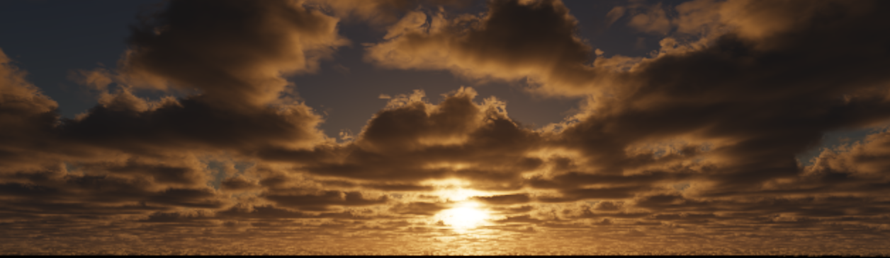

## Highlights

### Visibility-Buffer Deferred Pipeline

The geometry pass writes a compact **visibility buffer** (packed surface + primitive IDs) and depth; a compute **surface-resolve** pass reconstructs each pixel's triangle analytically, caches normals/material data for lighting, and generates camera motion vectors. Reverse-Z depth throughout.

- Triangle attributes reconstructed with analytic perspective-correct barycentrics and UV gradients, avoiding full material writes during the geometry pass
- Octahedral-encoded normals + packed material output, resolved only when downstream passes need them
- Voxel terrain pixels reconstruct diced geometry and reuse the erosion/micro-detail inputs for shading

### GPU-Driven Geometry

Two-phase occlusion culling at **instance and meshlet granularity**, single-dispatch Hi-Z (AMD FidelityFX SPD), task/mesh-shader cluster culling, and screen-space-error LOD selection. Main scene geometry is submitted through GPU-generated indirect commands via `ExecuteIndirect` / `vkCmdDrawMeshTasksIndirectCountEXT`.

- Two-phase scheme: render last-frame-visible first, rebuild Hi-Z, then re-test and disocclude — tracked down to per-meshlet granularity with a persistent visibility bitfield
- Hi-Z pyramid built in a single compute dispatch (FidelityFX SPD, min-reduction for reverse-Z)
- Task shader culls per meshlet (frustum / backface cone / Hi-Z) with wave-intrinsic compaction; mesh shader culls per triangle (backface + sub-pixel, `SV_CullPrimitive`)
- Meshlets and LOD chains (up to 8 levels) baked with meshoptimizer; LOD selected on GPU by projected screen-space error

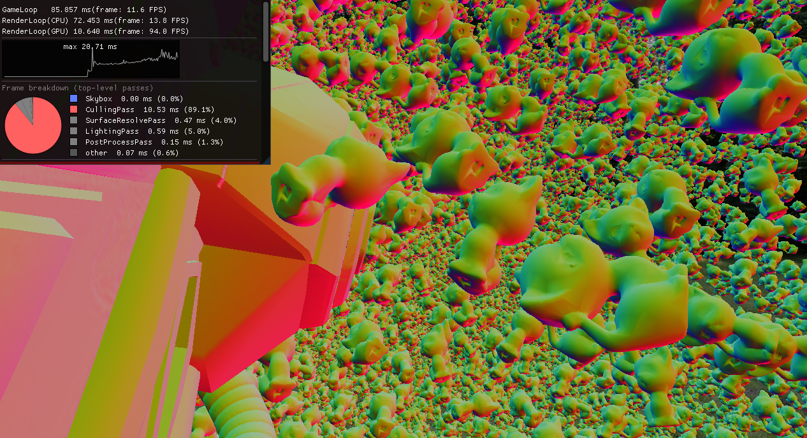
<p align="center"><i>Meshlet-culling stress test (normals debug view) — built-in profiler showing per-pass frame breakdown</i></p>

### Procedural Voxel Terrain — Fully GPU-Generated

A voxel chunk (128³ cells by default) is built on GPU — **SDF density field → marching cubes + Transvoxel transitions → Morton-order triangle sort → meshlet packing** — then rendered through the *same* GPU-driven culling and mesh-shader path as authored meshes. Micro-detail erosion is applied by **adaptive tessellation (compute dicing)** in the task/mesh shaders.

- SDF density from derivative-aware fBm with domain warp; marching cubes extracts directly into persistent GPU vertex slabs without reading generated geometry back to the CPU
- Triangles spatially re-ordered by a GPU Morton-order counting sort, then packed into meshlets on GPU for tight culling bounds
- Multi-chunk LOD streaming with **Transvoxel** transition cells to close cracks between chunks at different LODs
- **Geomorphing & dithered crossfade** to reduce LOD popping as geometry transitions between detail levels
- LOD0 compute dicing: distance-based per-meshlet subdivision budgets with per-edge levels and neighbor snapping
- Erosion detail baked into a 512² detail/ridge map per chunk (plus an apron), using a Runevision-style directional erosion filter, displacement, and analytic micro-noise

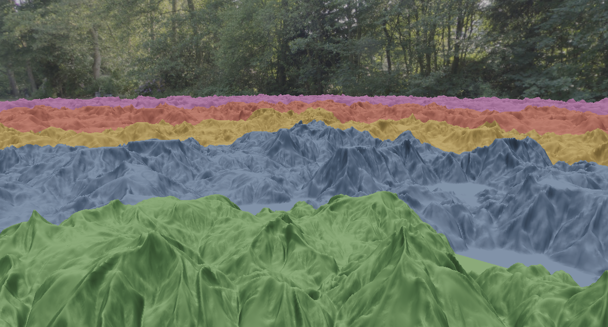
<p align="center"><i>Multi-chunk voxel streaming — GPU-generated geometry with erosion detail from compute dicing</i></p>

### Clustered Lighting & Area Lights

Clustered light culling (64 px tiles × 32 logarithmic depth slices, GPU-compacted light lists) feeding a full-screen compute PBR resolve; **six analytic light types with photometric units** (lux / lumens) and Kelvin color temperature, including rect and disk area lights via **Linearly Transformed Cosines** (Heitz 2016).

- Cook-Torrance GGX shading; light influence radii derived from luminous flux ("Moving Frostbite to PBR")
- LTC area/disk lights with full horizon clipping; sphere/tube lights via representative-point specular with a normalization correction
- Per-pixel composition of aerial perspective and cloud scattering in the lighting resolve

<table>
  <tr>
    <td>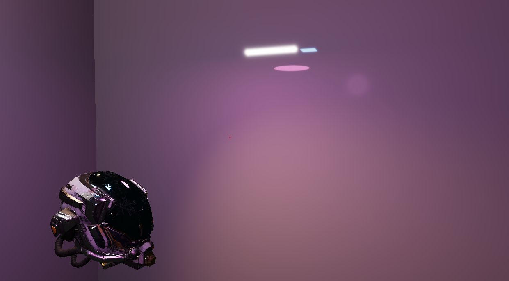</td>
    <td>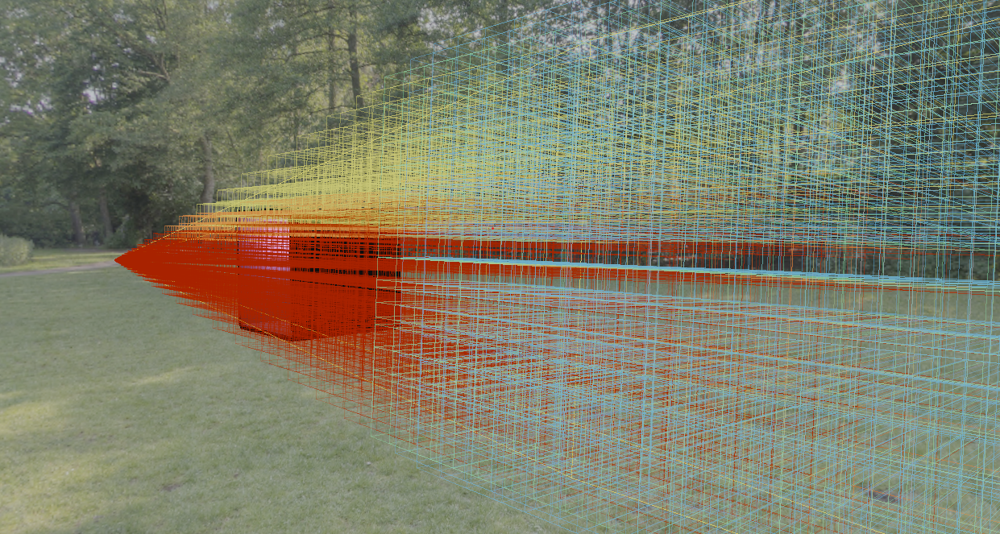</td>
  </tr>
  <tr>
    <td align="center"><i>Analytic area lights (rect · disk · tube)</i></td>
    <td align="center"><i>Cluster debug overlay — per-cluster light-count heatmap</i></td>
  </tr>
</table>

### Sky & Volumetrics

**Hillaire-style (SIGGRAPH 2020) atmosphere LUT stack** — transmittance, multi-scattering, sky-view, aerial-perspective froxels, distant-sky-light ambient, and a per-frame skybox bake — plus **Nubis-style volumetric clouds** with multi-scattering octaves and temporal upscaling.

- Six-LUT atmosphere pipeline with Rayleigh + Mie + ozone profiles; transmittance and multi-scattering LUTs are cached until atmosphere parameters change
- Clouds: weather-map-shaped fBm noise volume, blue-noise-jittered raymarch, blended HG/Draine phase functions, multi-scattering octaves, temporal upscaling to full resolution
- Per-frame 512² Beer shadow map from the sun's view (implemented ahead of its consumer passes)
- Dynamic skybox re-baked every frame from the sky-view LUT with an analytic sun disk; static HDR-cubemap path included

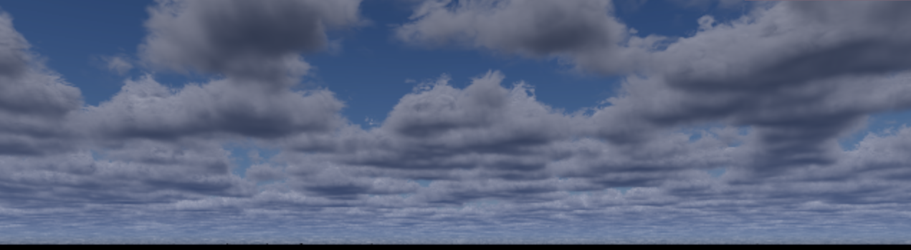
<p align="center"><i>Volumetric clouds — daytime, multi-scattering octaves with temporal upres</i></p>

### DXR Path Tracing

Iterative progressive path tracer (**NEE + power-heuristic MIS**, Russian roulette) with surface and volume transport. Matched-scene validation uses **PBRT-v4**, **Mitsuba 3**, and **Guo et al.'s layered-BSDF reference implementation**, with comparisons of linear EXR radiance, noise, and convergence across sample counts and random seeds.

The author defines the validation criteria and performs the final visual review. **AI agents (vibe coding)** develop the validation tooling and run the matched-scene comparisons.

- Composite BSDF with Burley diffuse, anisotropic GGX/VNDF, conductors, smooth/rough dielectrics, clearcoat, and sheen; one-sample lobe selection and a combined PDF for MIS support glTF-style and Disney-principled materials
- N-layered BSDF with stochastic internal walks; nested dielectric medium state and camera-inside initialization
- Heterogeneous absorption and scattering from **NanoVDB density grids**: global-majorant null-collision tracking, Henyey–Greenstein phase sampling, volume NEE/MIS, and ratio-tracked shadow transmittance
- Separate nested host-medium and additive air-field state, including smoke enclosed by glass; trilinear density sampling with transformed volume instances
- Owen-scrambled Sobol sampling with separate PCG streams; normal mapping, tangent-space anisotropy, and ray-cone texture LOD
- Environment maps importance-sampled via a precomputed 2D CDF; six analytic light types shared with the raster pipeline
- CLI-driven scene, seed, and SPP batches with EXR/AOV dumps for reference validation; comparison criteria are specific to each scene and matched feature set
- Cached BLAS / on-demand TLAS management; progressive accumulation with automatic invalidation on camera or scene changes

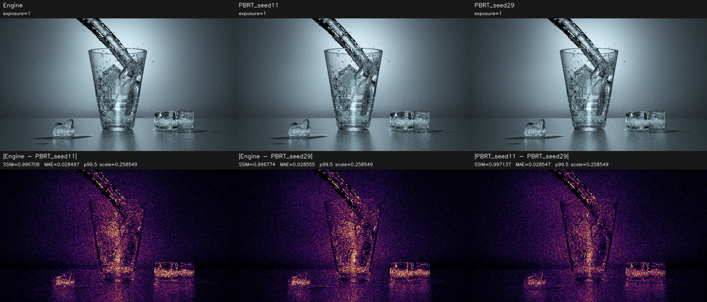
<p align="center"><i>The Water Glass — engine radiance vs PBRT-v4 references with absolute-difference maps</i></p>

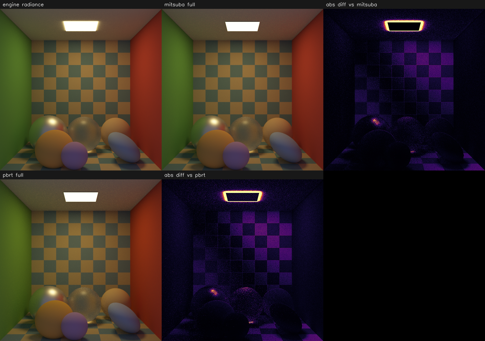
<p align="center"><i>Material test box (conductor · rough dielectric · principled) — engine vs Mitsuba 3 / PBRT-v4</i></p>

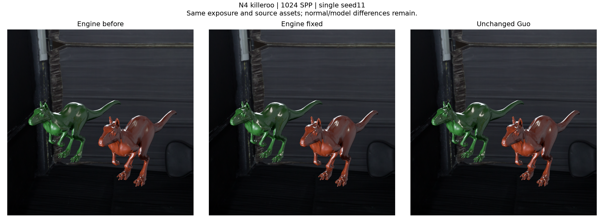
<p align="center"><i>Four-layer Killeroo material — engine vs Guo et al.'s reference implementation</i></p>

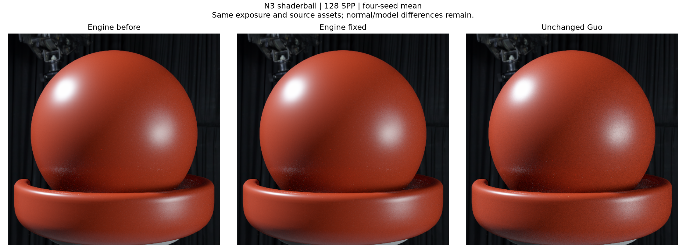
<p align="center"><i>Layered material shaderball — engine vs Guo et al.'s reference implementation. Geometry: <a href="Assets/Model/USDShaderBallForGltf/README.md#legal">USD Shader Ball for glTF</a> (CC BY 4.0).</i></p>

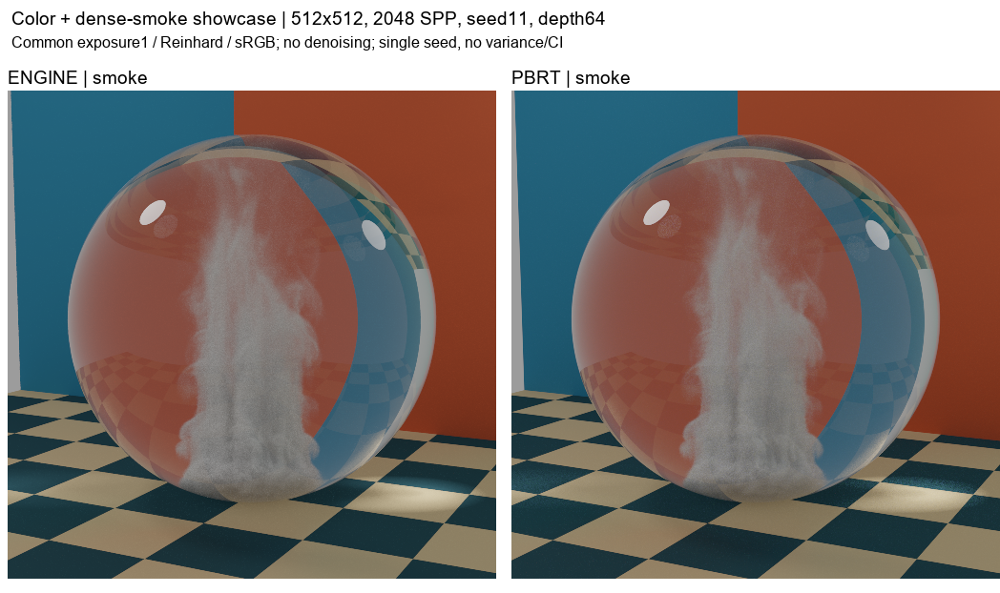
<p align="center"><i>Heterogeneous smoke inside a glass sphere — matched engine / PBRT-v4 scene</i></p>

### Post-Processing

- TAA with Halton jitter, Catmull-Rom history resampling, YCoCg variance clipping, and optional sharpening
- Six-level multiscale bloom
- EV100 exposure with selectable ACES / Uncharted 2 / Reinhard / Uchimura tone mapping

## Architecture

The diagrams below are exported from [Renderer_Architecture.html](Docs/Renderer_Architecture.html). Download and open that document in a browser for the full page; GitHub README displays the static SVG exports. Click a diagram to inspect it at full size.

### Engine & Backend Layers

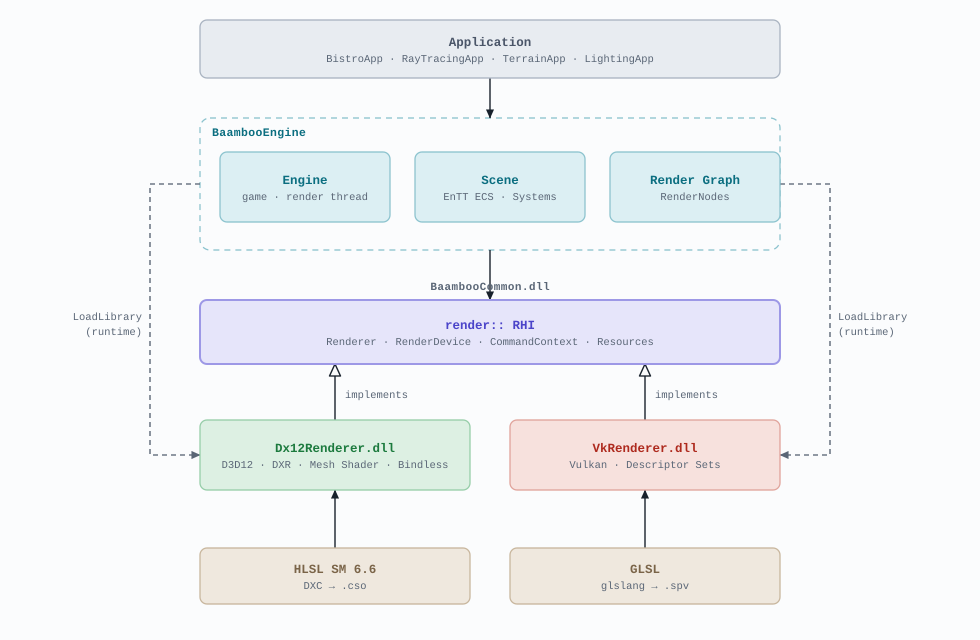

<details>
<summary><b>Frame pipeline</b></summary>

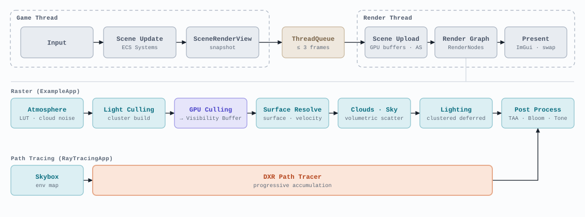

</details>

<details>
<summary><b>GPU-driven culling</b></summary>

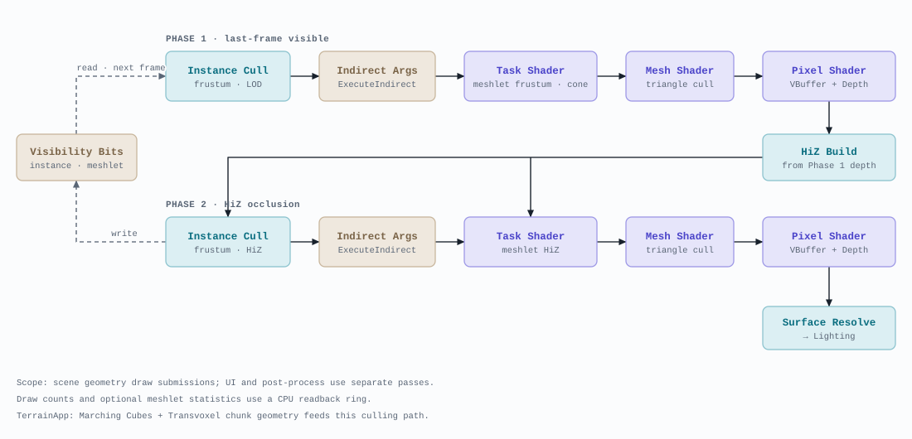

</details>

<details>
<summary><b>DXR path tracing</b></summary>

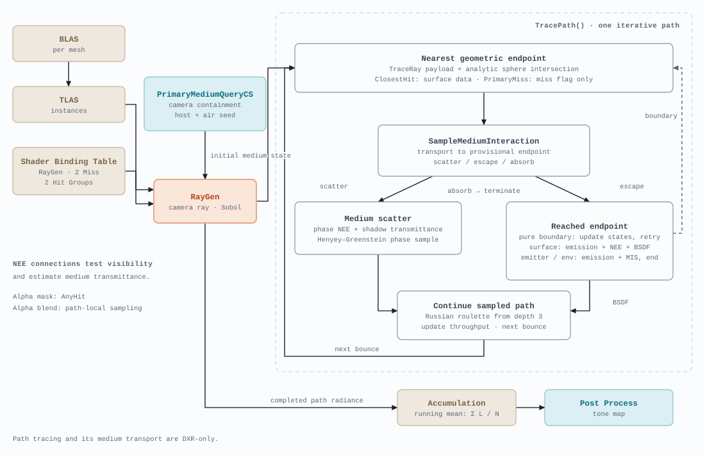

</details>

<details>
<summary><b>Heterogeneous medium</b></summary>

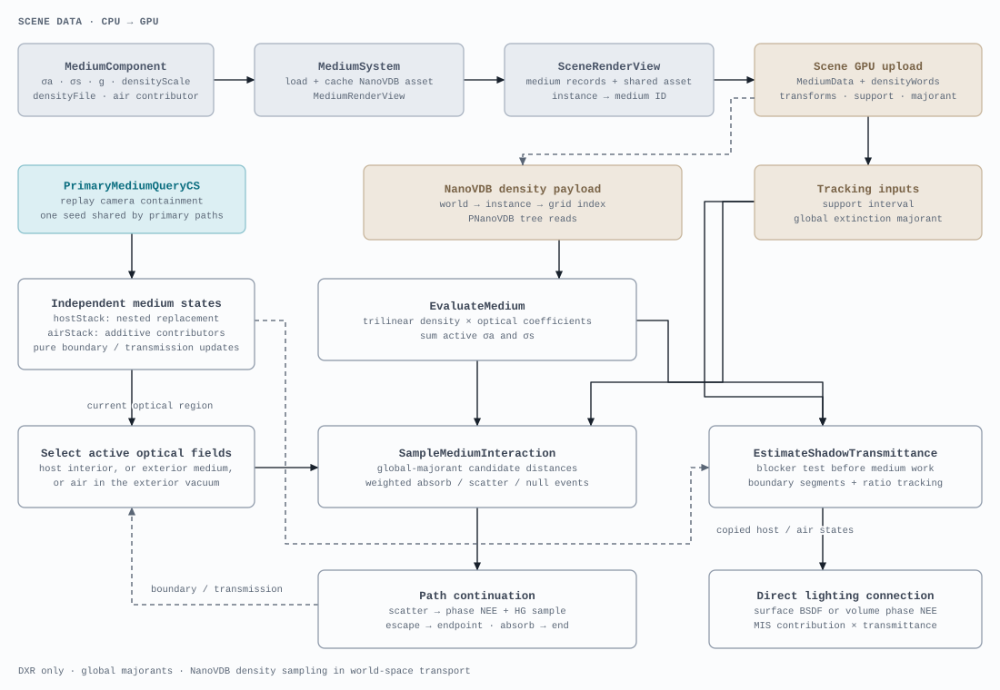

</details>

## Sample Applications

| Sample | Focus |
|---|---|
| `ExampleApp` | Atmosphere and cloud showcase — dynamic skybox, clustered lighting |
| `BistroApp` | Load test for the meshlet-culling pipeline — massively instanced scenes stressing two-phase culling and LOD selection |
| `LightingApp` | Clustered light culling, LTC area lights |
| `TerrainApp` | GPU-generated voxel terrain — multi-chunk LOD, Transvoxel, erosion detail, compute dicing |
| `RayTracingApp` | DXR progressive path tracer, with AOV-dump automation for reference validation |

## Building

**Requirements**

- Windows 10/11, Visual Studio 2022 or 2026 with **Desktop development with C++** (C++23)
- Compatible CMake: **3.24+ for VS 2022** or **4.2+ for VS 2026**; the generator prefers CMake bundled with the selected Visual Studio installation
- [Vulkan SDK](https://vulkan.lunarg.com/) — `VULKAN_SDK` must be set; the GLSL build currently targets `vulkan1.4`, while the backend requests Vulkan 1.3
- Mesh-shader support for the raster samples; D3D12/DXR 1.1 support for the path-tracing sample

**Hardware coverage:** Tested only on **NVIDIA GeForce RTX 4080 and RTX 3070**. Other GPUs and drivers have not been validated. Performance and VRAM requirements depend on the scene and rendering settings.

```bat
git clone --recursive https://github.com/baamdoo/BaambooRenderer.git
cd BaambooRenderer
GenerateProject.bat
```

The generator selects Visual Studio 2026 when available, otherwise 2022.  
Open the generated solution, build, and run the `Application` project. The active sample is selected in `Projects/Application/main.cpp`; the path tracer also accepts CLI scene and batch options. NuGet packages (D3D12 Agility SDK, DXC, DirectXTK12, DirectXTex, WinPixEventRuntime) are restored automatically on first build.

## Third-Party

| Area | Libraries / tools |
|---|---|
| Scene, window, math & UI | [EnTT](https://github.com/skypjack/entt), [GLFW](https://github.com/glfw/glfw), [glm](https://github.com/g-truc/glm), [Dear ImGui](https://github.com/ocornut/imgui), [magic_enum](https://github.com/Neargye/magic_enum) |
| Geometry import & processing | [assimp](https://github.com/assimp/assimp), [meshoptimizer](https://github.com/zeux/meshoptimizer), [Transvoxel tables](https://transvoxel.org/) |
| Images & volumes | [stb](https://github.com/nothings/stb), [gli](https://github.com/g-truc/gli), [tinyexr](https://github.com/syoyo/tinyexr) and its [miniz](https://github.com/richgel999/miniz) dependency, [OpenVDB/NanoVDB](https://github.com/AcademySoftwareFoundation/openvdb) |
| GPU memory | [D3D12MemoryAllocator](https://github.com/GPUOpen-LibrariesAndSDKs/D3D12MemoryAllocator), [VulkanMemoryAllocator](https://github.com/GPUOpen-LibrariesAndSDKs/VulkanMemoryAllocator) |
| GPU downsampling | [AMD FidelityFX SPD](https://github.com/GPUOpen-Effects/FidelityFX-SPD), used for Hi-Z generation |
| D3D12 SDK & support | [Agility SDK](https://devblogs.microsoft.com/directx/directx12agility/), [DXC](https://github.com/microsoft/DirectXShaderCompiler), [DirectXTK12](https://github.com/microsoft/DirectXTK12), [DirectXTex](https://github.com/microsoft/DirectXTex), [WinPixEventRuntime](https://devblogs.microsoft.com/pix/download/) |
| Vulkan SDK & shaders | [Vulkan SDK](https://vulkan.lunarg.com/), [glslang](https://github.com/KhronosGroup/glslang), [SPIRV-Cross](https://github.com/KhronosGroup/SPIRV-Cross) |
| Build tools | [Premake5](https://premake.github.io/), [CMake](https://cmake.org/) |

Additional checked-out dependencies: [taskflow](https://github.com/taskflow/taskflow), [nlohmann/json](https://github.com/nlohmann/json), and [pugixml](https://github.com/zeux/pugixml). These are currently available in the dependency tree without active engine consumers.

## Reference

Sources cited in the engine and shader comments, plus the reference renderers and asset sources used by the validation tools.

### General

- PBRT: [Physically Based Rendering, 4th edition](https://pbr-book.org/4ed/contents), [PBRT-v4 renderer](https://github.com/mmp/pbrt-v4) and [reference scenes](https://github.com/mmp/pbrt-v4-scenes).
- [Unreal Engine — rendering implementation references](https://github.com/EpicGames/UnrealEngine) (requires an Epic-linked GitHub account).
- [Mitsuba 3 — reference renderer](https://github.com/mitsuba-renderer/mitsuba3).
- [Falcor — rendering framework](https://github.com/NVIDIAGameWorks/Falcor).
- [meshoptimizer — meshlets, simplification and LOD](https://github.com/zeux/meshoptimizer).
- OpenVDB / NanoVDB: [source](https://github.com/AcademySoftwareFoundation/openvdb), [documentation](https://www.openvdb.org/documentation/) and [sample volumes](https://www.openvdb.org/download/).
- Microsoft DirectX: [DXR / inline ray tracing](https://microsoft.github.io/DirectX-Specs/d3d/Raytracing.html#inline-raytracing), [SM 6.6 dynamic resources](https://microsoft.github.io/DirectX-Specs/d3d/HLSL_SM_6_6_DynamicResources.html).

### Surface scattering and lighting

- [Lagarde — Memo on Fresnel equations](https://seblagarde.wordpress.com/2013/04/29/memo-on-fresnel-equations/).
- [Walter et al. — Microfacet Models for Refraction through Rough Surfaces](https://doi.org/10.2312/EGWR/EGSR07/195-206).
- [Heitz — Sampling the GGX Distribution of Visible Normals](https://jcgt.org/published/0007/04/01/paper.pdf).
- [Burley — Physically-Based Shading at Disney](https://blog.selfshadow.com/publications/s2012-shading-course/burley/s2012_pbs_disney_brdf_notes_v3.pdf).
- [Kulla and Conty — Revisiting Physically Based Shading at Imageworks](https://blog.selfshadow.com/publications/s2017-shading-course/imageworks/s2017_pbs_imageworks_slides_v2.pdf).
- [Linearly Transformed Cosines — reference implementation](https://github.com/selfshadow/ltc_code).
- [Lagarde and de Rousiers — Moving Frostbite to Physically Based Rendering](https://blog.selfshadow.com/publications/s2014-shading-course/).
- [Guo, Hašan and Zhao — Position-Free Monte Carlo Simulation for Arbitrary Layered BSDFs](https://projects.shuangz.com/layered-sa18/).
- [EfficientComplexLayered — distribution of the `multilayered_guo2018` plugin used for validation](https://github.com/leggcg/EfficientComplexLayered).

### Sampling, visibility and texture filtering

- [O'Neill — PCG](https://www.pcg-random.org/paper.html).
- [Burley — Practical Hash-based Owen Scrambling](https://jcgt.org/published/0009/04/01/paper.pdf).
- [Joe and Kuo — Sobol direction numbers](https://web.maths.unsw.edu.au/~fkuo/sobol/).
- [Duff et al. — Building an Orthonormal Basis, Revisited](https://jcgt.org/published/0006/01/01/).
- [Ameye — Sampling the hemisphere](https://ameye.dev/notes/sampling-the-hemisphere/).
- [Akenine-Möller et al. — Improved Shader and Texture Level of Detail Using Ray Cones](https://www.jcgt.org/published/0010/01/01/paper-lowres.pdf).
- [Mara and McGuire — 2D Polyhedral Bounds of a Clipped, Perspective-Projected 3D Sphere](https://jcgt.org/published/0002/02/05/paper.pdf).

### Atmosphere and clouds

- Hillaire: [UnrealEngineSkyAtmosphere](https://github.com/sebh/UnrealEngineSkyAtmosphere), [Physically-based and Unified Volumetric Rendering in Frostbite](https://sebh.github.io/publications/) and [Physically Based and Scalable Atmospheres in Unreal Engine](https://blog.selfshadow.com/publications/s2020-shading-course/hillaire/s2020_pbs_hillaire_slides.pdf).
- Schneider / Guerrilla: [Real-Time Volumetric Cloudscapes](https://www.schneidervfx.com/), [Nubis: Authoring Real-Time Volumetric Cloudscapes with the Decima Engine](https://www.guerrilla-games.com/read/nubis-authoring-real-time-volumetric-cloudscapes-with-the-decima-engine) and [Nubis, Cubed](https://www.guerrilla-games.com/read/nubis-cubed).
- [Jendersie and d'Eon — An Approximate Mie Scattering Function for Fog and Cloud Rendering](https://research.nvidia.com/labs/rtr/approximate-mie/).

### Terrain and noise

- [Lengyel — Transvoxel](https://transvoxel.org/).
- [Quilez — More noise](https://iquilezles.org/articles/morenoise/).
- [Runevision — Fast and Gorgeous Erosion Filter](https://blog.runevision.com/2026/03/fast-and-gorgeous-erosion-filter.html).
- [Shadertoy noise/hash example — 3dVXDc](https://www.shadertoy.com/view/3dVXDc).
- [Shadertoy noise/hash example — NlSGDz](https://www.shadertoy.com/view/NlSGDz).
- [MurmurHash](https://sites.google.com/site/murmurhash/).

### Post-processing and utilities

- [Jimenez — Next Generation Post Processing in Call of Duty: Advanced Warfare](https://advances.realtimerendering.com/s2014/index.html).
- [Karis — High-Quality Temporal Supersampling](https://advances.realtimerendering.com/s2014/index.html).
- [Salvi — Temporal Supersampling](https://developer.download.nvidia.com/gameworks/events/GDC2016/msalvi_temporal_supersampling.pdf).
- [Catmull–Rom filtering example](https://www.shadertoy.com/view/MtVGWz).
- [Uchimura — HDR theory and practice](https://www.slideshare.net/nikuque/hdr-theory-and-practicce-jp).
- [Mikhailov — Turbo colormap approximation](https://gist.github.com/mikhailov-work/ee72ba4191942acecc03fe6da94fc73f).
- [PIX capture integration](https://devblogs.microsoft.com/pix/taking-a-capture/).
